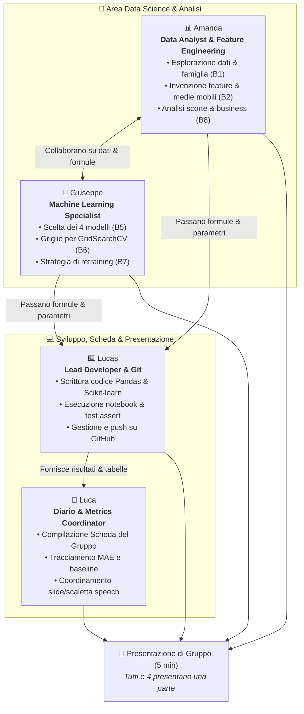

# 🚀 Project Work 2 · Machine Learning
## 📋 Piano di Lavoro Collaborativo (Team da 4)

Benvenuti nel piano operativo per il **Project Work 2: La catena di montaggio di un modello**.  
In questo assetto il lavoro è distribuito in modo equilibrato e collaborativo: **nessuno lavora da solo**, ogni ruolo contribuisce direttamente al codice e all'analisi, e **la presentazione di 5 minuti sarà divisa tra tutti e 4 i componenti** (circa 1 minuto e 15 secondi a testa).

---

### 👥 Il Team e la Ripartizione delle Responsabilità

---

### 📌 Dettaglio dei Ruoli e delle Mansioni

| Componente | Focus Operativo | Compiti Specifici |
|---|---|---|
| **⌨️ Lucas** | **Tastiera & Version Control** | • Scrive ed esegue il codice nel notebook. • Risolve gli errori e verifica che ogni cella dia `OK`. • Esegue `git push` a ogni blocco per allineare il team. |
| **📊 Amanda** | **Dati, Feature & Magazzino** | • **Blocco 1:** Analisi dei grafici di vendita e comportamento articoli. • **Blocco 2:** Progetta e testa le feature matematiche (medie mobili, trend, deviazioni). • **Blocco 8:** Analisi di business delle scorte (`safety stock`) rispetto al sistema reale. |
| **🤖 Giuseppe** | **Algoritmi & Ottimizzazione** | • **Blocco 5:** Seleziona i 4 modelli (LinearRegression, kNN, DecisionTree, RandomForest). • **Blocco 6:** Imposta le griglie di iperparametri per la Cross-Validation (`GridSearchCV`). • **Blocco 7:** Valuta l'impatto del retraining mensile su settembre. |
| **📝 Luca** | **Diario, Metriche & Scaletta** | • Compila la **Scheda del Gruppo** (Cella 42) in tempo reale. • Traccia la MAE della baseline e calcola il miglioramento percentuale `%`. • Prepara la scaletta e coordina i punti per la presentazione a 4. |

---

## 🤝 Come Collaborano tra loro (Le Sinergie)

1. **Amanda ↔️ Giuseppe (La coppia Data Science):**
   - Amanda si focalizza sui **dati e sulle colonne** (cosa insegnare all'algoritmo).
   - Giuseppe si focalizza sui **modelli e sul tuning** (quale algoritmo impara meglio).
   - Insieme decidono quali feature aiutano di più i rispettivi modelli.

2. **Amanda & Giuseppe ➡️ Lucas (Dalla teoria al codice):**
   - Amanda e Giuseppe passano a Lucas le formule matematiche e i parametri da inserire nelle funzioni.
   - Lucas scrive il codice Pandas/Scikit-learn, fa girare il kernel e verifica i controlli `assert`.

3. **Lucas ➡️ Luca (Dal codice alla documentazione):**
   - Appena la cella dà `OK`, Lucas passa a Luca i numeri (MAE test, MAE cross-validation, parametri scelti).
   - Luca trascrive tutto nella scheda ufficiale e formula le risposte di riflessione.

---

## ⏱️ Tabella di Marcia Passo-Passo (Oggi: Blocchi 1 – 6)

### 🔹 Blocco 1 · Scelta della Famiglia (Con quali dati lavoriamo?)
- **Amanda:** Analizza le famiglie e propone quella migliore (es. *Tenute e guarnizioni* o *Valvole del compressore*). Esamina i 6 grafici di esempio per capire se la domanda è costante o a picchi.
- **Lucas:** Inserisce il nome della famiglia in `load_family` e scrive la condizione `total_sold >= min_total`.
- **Luca:** Segna nella scheda il nome della famiglia e il numero di articoli attivi rimasti.

### 🔹 Blocco 2 · Feature Engineering (Cosa diamo in pasto al modello?)
- **Amanda:** Progetta le 4 feature chiave da aggiungere ai lag:
  1. `media_6_mesi`: media delle uscite nei 6 mesi precedenti.
  2. `std_6_mesi`: deviazione standard (misura l'instabilità della domanda).
  3. `trend_recente` (`lag_1 - lag_2`): direzione delle vendite (in salita o discesa).
  4. `max_6_mesi`: picco massimo recente.
- **Lucas:** Inserisce le colonne dentro `make_examples` ed esegue il controllo `assert`.
- **Luca:** Trascrive nella scheda i nomi delle colonne e la motivazione per cui dovrebbero aiutare il modello.

### 🔹 Blocco 3 & 4 · Split Temporale e Baseline
- **Giuseppe:** Spiega perché usiamo uno split temporale (luglio-agosto 2026 come test) e non casuale (evitare contaminazione dati dal futuro).
- **Lucas:** Completa `is_test = examples["target_month"].isin(test_months)` e calcola la baseline (media delle ultime 3 colonne).
- **Luca:** Segna la **MAE Baseline** nella scheda: è il punteggio ufficiale da battere!

### 🔹 Blocco 5 · Gara tra Modelli
- **Giuseppe:** Definisce i 4 modelli candidati (`LinearRegression`, `KNeighborsRegressor`, `DecisionTreeRegressor`, `RandomForestRegressor`).
- **Lucas:** Completa `train_model` (`fit`) ed `evaluate_model` (`mean_absolute_error`) ed esegue la gara.
- **Luca:** Scrive la classifica ordinata per MAE nella scheda del gruppo.
- **Amanda:** Esamina quale modello ha risposto meglio alle feature create nel Blocco 2.

### 🔹 Blocco 6 · Tuning Iperparametri & Sigillo
- **Giuseppe:** Imposta la griglia di ricerca per `GridSearchCV` (es. $k$ per kNN e profondità/stimatori per Random Forest).
- **Lucas:** Scrive `choose_hyperparameters` con 5 parti di cross-validation e seleziona il `chosen_model`.
- **Luca:** Registra gli iperparametri ottimali e il miglioramento percentuale finale `%`.
- **Tutto il team:** Va a scrivere il proprio miglioramento percentuale alla lavagna dell'aula!

---

## 🎤 La Presentazione di Venerdì (5 Minuti Divisi tra Tutti)

Nessuno deve parlare per 5 minuti da solo: ciascuno espone esattamente la parte su cui ha lavorato per circa **1 minuto e 15 secondi**:

1. **Amanda (~1 min):** *Introduzione & Dati.* Racconta la famiglia scelta, come si comportano gli articoli (regolari vs a picchi) e le feature inventate nel Blocco 2.
2. **Lucas (~1 min):** *Pipeline & Implementazione.* Spiega come è stata montata la catena (split temporale senza barare, feature engineering in Pandas, pulizia del codice).
3. **Giuseppe (~1 min):** *Modelli & Ottimizzazione.* Racconta la gara tra i 4 modelli, perché certi algoritmi hanno faticato e come la cross-validation ha scelto gli iperparametri ideali.
4. **Luca (~1 min):** *Risultati, Settembre & Decisione Aziendale.* Mostra il miglioramento finale rispetto alla baseline, il comportamento sul mese nuovo (settembre) e il confronto con le scorte reali dell'azienda.
