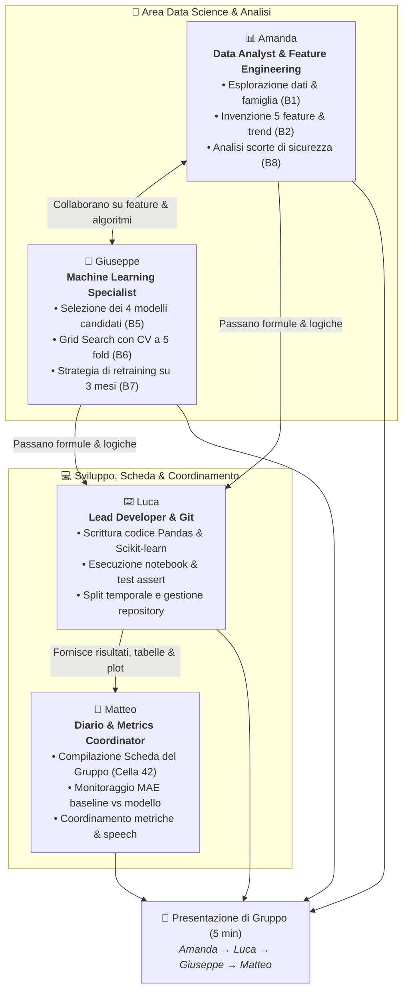

# 🚀 Project Work 2 · Machine Learning
## 📋 Piano di Lavoro Collaborativo & Stato Avanzamento (Team da 4)

Benvenuti nel documento di lavoro e tracciamento del **Project Work 2: La catena di montaggio di un modello**.  
In questo assetto il lavoro è stato distribuito in modo equilibrato e collaborativo tra i 4 componenti del gruppo: **Amanda, Luca, Giuseppe e Matteo**.

Tutti i blocchi operativi (1–8) sono stati **completati con successo**, tutti i test `assert` restituiscono `OK` e la presentazione finale di 5 minuti è pronta e suddivisa in parti uguali (circa 1 minuto e 15 secondi a testa).

---

### 👥 Il Team e la Ripartizione delle Responsabilità



---

### 📌 Dettaglio dei Ruoli e delle Mansioni

| Componente | Focus Operativo | Compiti Svolti |
|---|---|---|
| **📊 Amanda** | **Dati, Feature & Magazzino** | • **Blocco 1:** Selezione famiglia *Tenute e guarnizioni* (765 articoli attivi con vendite $\ge 12$). Analisi dei pattern di vendita (regolari, a ondate, picco unico).<br/>• **Blocco 2:** Progettazione delle 5 nuove feature matematiche.<br/>• **Blocco 8:** Analisi di business sulle scorte di sicurezza rispetto al sistema aziendale. |
| **⌨️ Luca** | **Tastiera & Lead Developer** | • **Blocco 3:** Implementazione dello split temporale onesto (nessuna fuga di dati dal futuro).<br/>• **Blocco 4:** Creazione della baseline basata sulla media mobile a 3 mesi.<br/>• Scrittura e manutenzione del codice notebook, superamento controlli `assert` e versioning Git/GitHub. |
| **🤖 Giuseppe** | **Algoritmi & Ottimizzazione** | • **Blocco 5:** Configurazione della gara tra 4 modelli (`LinearRegression`, `kNN`, `DecisionTree`, `RandomForest`).<br/>• **Blocco 6:** Tuning con `GridSearchCV` a 5 fold e selezione del modello sigillato (*Random Forest*).<br/>• **Blocco 7:** Implementazione della strategia di riallenamento incrementale mese per mese. |
| **📝 Matteo** | **Diario & Metrics Coordinator** | • Compilazione completa della **Scheda del Gruppo** (Cella 42).<br/>• Tracciamento e confronto delle MAE (Baseline: 6.79 vs Random Forest: 6.67 $\rightarrow$ +1.8%).<br/>• Analisi delle performance sul mese non visto di settembre (+2.6% vs baseline) e coordinamento presentazione. |

---

## 📊 Stato Avanzamento: Cosa Abbiamo Fatto (Blocchi 1 – 8)

Tutti i blocchi sono stati completati con successo e convalidati:

| Blocco | Obiettivo & Attività | Esito & Metriche Chiave | Stato |
|:---:|:---|:---|:---:|
| **1** | **Con quali dati lavoro?** Caricamento dataset, selezione della famiglia *Tenute e guarnizioni*, filtro articoli attivi ($\ge 12$ pezzi). | **765 articoli attivi** selezionati su 7.771 totali. | ✅ **OK** |
| **2** | **Cosa do in pasto al modello?** Creazione di 5 feature: `media_6_mesi`, `std_6_mesi`, `trend_recente` ($lag_1 - lag_2$), `max_6_mesi`, `lead_time_days`. | **8.415 esempi** generati con 8 feature complessive in $X$. | ✅ **OK** |
| **3** | **Quando il test è onesto?** Split temporale rigoroso: Train (aprile 2025 – giugno 2026), Test (luglio – agosto 2026). Nessuna contaminazione temporale. | **6.885 train**, **1.530 test**. | ✅ **OK** |
| **4** | **Battere la baseline?** Calcolo della baseline predittiva semplice (media uscite degli ultimi 3 mesi). | **MAE Baseline = 6.79 pezzi** (soglia minima da battere). | ✅ **OK** |
| **5** | **Gara tra modelli:** Addestramento e test di Linear Regression, kNN ($k=5$), Decision Tree e Random Forest. | **Vince Random Forest** con **MAE = 6.67** (kNN crolla a 14.62). | ✅ **OK** |
| **6** | **Tuning iperparametri:** Ottimizzazione con 5-fold CV. Sigillo del modello definitivo. | Modello sigillato: **Random Forest** (200 alberi, depth 5). **MAE 6.67 (+1.8% vs baseline)**. | ✅ **OK** |
| **7** | **Riallenare ogni mese?** Test su settembre 2026 con modello fisso vs modello riallenato mensilmente. | Settembre difficile (post-ferie): **MAE 15.96 vs baseline 16.39 (+2.6%)**. Riallenare varia per mese (diff media -0.063 pezzi). | ✅ **OK** |
| **8** | **Decisione operativa di magazzino:** Calcolo scorta di sicurezza ($SS$) e punto di riordino ($ROP$) per ottobre 2026 e confronto con il sistema reale. | Nostro $ROP$ medio: 16.3 pezzi vs 30.4 del sistema. Valore merce: 322k€ vs 293k€. | ✅ **OK** |

---

## 🎤 La Presentazione di Gruppo (5 Minuti Divisi tra Tutti)

Ciascun componente espone la propria sezione per circa **1 minuto e 15 secondi**:

```
[00:00 - 01:15] 📊 Amanda  : Dati, Famiglia & Feature Engineering (Blocchi 1 & 2)
[01:15 - 02:30] ⌨️ Luca    : Pipeline, Split Temporale & Baseline (Blocchi 3 & 4)
[02:30 - 03:45] 🤖 Giuseppe: Modelli, Tuning con CV & Modello Sigillato (Blocchi 5 & 6)
[03:45 - 05:00] 📝 Matteo  : Settembre, Retraining, Scorte Aziendali & Conclusioni (Blocchi 7 & 8)
```

Per i dettagli dello speech consultare [PRESENTAZIONE.md](PRESENTAZIONE.md) o aprire l'interfaccia interattiva a slide in [presentazione.html](presentazione.html).
