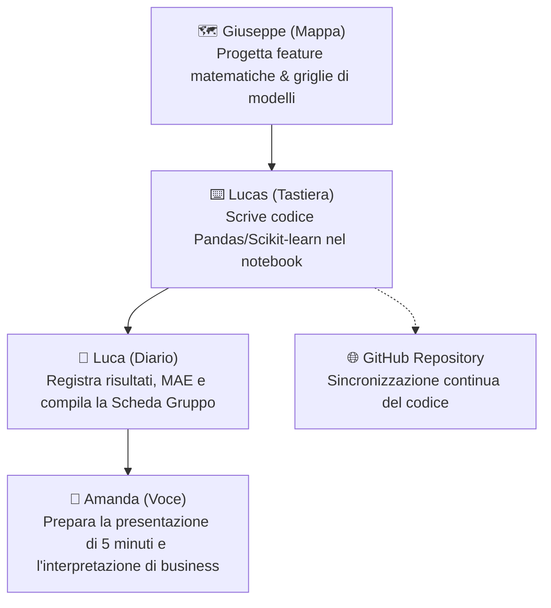

# 🚀 Project Work 2 · Machine Learning
## 📋 Piano di Lavoro e Assegnazione Ruoli del Team

Benvenuti nel piano operativo per il **Project Work 2: La catena di montaggio di un modello**.  
Questo documento definisce in modo chiaro e dettagliato i compiti di ciascun membro del gruppo per le giornate di **mercoledì (Oggi: Blocchi 1–6)** e **venerdì (Blocchi 7–8 e Presentazione Finale)**.

---

### 👥 Il Team e i Ruoli Ufficiali

| Componente | Ruolo Ufficiale | Focus Principale |
|---|---|---|
| **⌨️ Lucas** | **Tastiera** *(Lead Developer & Git)* | Scrive ed esegue il codice nel notebook, risolve i controlli `assert` e gestisce i commit su GitHub. |
| **🗺️ Giuseppe** | **Mappa** *(Data Scientist & Algoritmi)* | Consulta documentazione scikit-learn e slide: progetta le feature (colonne), seleziona i modelli e definisce le griglie per gli iperparametri. |
| **📝 Luca** | **Diario** *(Metrics Tracker & Documenter)* | Compila in tempo reale la **Scheda del gruppo** in fondo al notebook, monitora le metriche (MAE, miglioramento %) e risponde alle domande analitiche. |
| **🎤 Amanda** | **Voce** *(Business Analyst & Speaker)* | Guida l'analisi qualitativa dei dati aziendali, prepara la scaletta e le slide della presentazione di 5 minuti per venerdì. |

---

### 🔄 Flusso di Lavoro Collaborativo



---

## 📌 Scheda di Dettaglio per Singolo Membro

### ⌨️ Lucas · Il Ruolo della Tastiera (Sviluppo & Git)
> *"Non si va avanti senza il via libera dei controlli automatici."*

- **I tuoi compiti principali:**
  1. **Scrittura del codice:** Prendi le idee e formule di Giuseppe e le traduci in codice pulito con Pandas e Scikit-Learn.
  2. **Esecuzione delle celle:** Esegui le celle sempre rigorosamente dall'alto verso il basso.
  3. **Superamento degli assert:** Controlli che ogni cella di verifica stampi `OK`.
  4. **Gestione del Version Control (Git):** 
     - Esegui commit regolari ad ogni blocco completato con successo:
       ```bash
       git add project_work_2_building_blocks.ipynb
       git commit -m "Completato Blocco X"
       git push origin main
       ```
  5. **Supporto al team:** Condividi a schermo o tramite repository le tabelle e i grafici aggiornati.

---

### 🗺️ Giuseppe · Il Ruolo della Mappa (Algoritmi & Feature)
> *"Senza la Mappa, nei blocchi 2, 5 e 6 il modello naviga al buio."*

- **I tuoi compiti principali:**
  1. **Blocco 1 (Scelta Famiglia):** Verifica la lista delle famiglie per trovarne una solida (consigliata: *Tenute e guarnizioni* o *Valvole del compressore*).
  2. **Blocco 2 (Invenzione Feature):** Progetta almeno 3-4 colonne matematiche intelligenti da dare a Lucas:
     - `media_6_mesi`: livello medio di consumo.
     - `std_6_mesi`: volatilità/incertezza della domanda.
     - `trend_recente` (`lag_1 - lag_2`): tendenza di crescita o calo.
     - `max_6_mesi`: picco massimo recente.
  3. **Blocco 5 (Scelta dei Modelli):** Seleziona i 4 algoritmi concorrenti da confrontare:
     - Regressione Lineare (`LinearRegression`)
     - Vicini più prossimi (`KNeighborsRegressor`)
     - Albero Decisionale (`DecisionTreeRegressor`)
     - Random Forest (`RandomForestRegressor`)
  4. **Blocco 6 (Griglia Iperparametri):** Scegli quali parametri testare con `GridSearchCV` (es. numero di vicini $k$, profondità dell'albero `max_depth`, numero di stimatori `n_estimators`).

---

### 📝 Luca · Il Ruolo del Diario (Scheda del Gruppo & Metriche)
> *"La scheda non si compila alla fine: si aggiorna ad ogni passo."*

- **I tuoi compiti principali:**
  1. **Compilazione della Scheda (Cella 42 del notebook):** Compili man mano ogni singola voce richiesta dal docente.
  2. **Tracciamento Metriche:**
     - Segni la **MAE della Baseline** (il benchmark da battere calcolato nel Blocco 4).
     - Ordini la classifica dei modelli del Blocco 5 dalla MAE più bassa alla più alta.
     - Riporti i migliori iperparametri trovati dalla Cross-Validation nel Blocco 6.
  3. **Risposte di Riflessione:** Rispondi alle domande aperte della scheda:
     - *Perché abbiamo inventato proprio quelle feature?*
     - *La classifica ci ha sorpreso? Perché un modello batte gli altri?*
     - *La MAE sul test è vicina a quella della cross-validation?*
  4. **Calcolo Miglioramento:** Calcoli la percentuale finale di miglioramento rispetto alla baseline (`(baseline - modello) / baseline * 100`).

---

### 🎤 Amanda · Il Ruolo della Voce (Presentazione & Storytelling Aziendale)
> *"I dati contano, ma il modo in cui raccontiamo la decisione all'azienda vince la gara."*

- **I tuoi compiti principali:**
  1. **Analisi qualitativa (Blocco 1):** Esamini i grafici a barre dei 6 articoli estratti a caso:
     - La domanda è regolare (XYZ tipo X) o a scatti (tipo Z)?
     - Ci sono articoli ad alto fatturato (classe A) o di contorno (classe C)?
  2. **Preparazione della Presentazione di 5 Minuti (Venerdì):**
     - Strutturi le slide o la scaletta del discorso in 4 punti:
       1. **Contesto & Famiglia:** Perché abbiamo scelto questa famiglia e che profilo di domanda ha.
       2. **Le nostre Feature:** Come abbiamo aiutato l'algoritmo a "capire" il trend.
       3. **Gara tra Modelli & Risultato:** Quale modello ha vinto e il miglioramento percentuale.
       4. **Settembre & Decisione Operativa:** Come si comporta su dati nuovi e il confronto con le scorte dell'azienda.
  3. **Scrittura alla lavagna (Oggi fine Blocco 6):** Porti alla lavagna del corso il miglioramento percentuale del gruppo per la classifica parziale!

---

## ⏱️ Tabella di Marcia: Oggi vs Venerdì

### 📅 OGGI (Blocchi 1 – 6) · Obiettivo: Modello Sigillato

| Blocco | Domanda Chiave | Chi fa cosa | Output Atteso |
|---|---|---|---|
| **Blocco 1** | *Con quali dati lavoro?* | **Giuseppe** seleziona la famiglia · **Lucas** scrive `load_family` · **Luca** segna gli articoli attivi · **Amanda** studia i pattern sui grafici. | `OK · blocco 1` |
| **Blocco 2** | *Che cosa do in pasto al modello?* | **Giuseppe** fornisce le formule · **Lucas** scrive `make_examples` con Pandas · **Luca** scheda le feature · **Amanda** annota perché sono rilevanti. | `OK · blocco 2` (almeno 6 feature) |
| **Blocco 3** | *Quando il test è onesto?* | **Lucas** fa lo split temporale (`2026-07` e `2026-08`) · **Giuseppe** spiega perché non si usa random split. | `OK · blocco 3` |
| **Blocco 4** | *Il modello batte una regola semplice?* | **Lucas** calcola la media a 3 mesi · **Luca** segna la **MAE Baseline** (numero da battere!). | `OK · blocco 4` |
| **Blocco 5** | *Come scelgo il modello?* | **Giuseppe** imposta i 4 modelli · **Lucas** esegue il training & test · **Luca** crea la classifica · **Amanda** evidenzia il vincitore. | `OK · blocco 5` |
| **Blocco 6** | *Come scelgo gli iperparametri?* | **Giuseppe** dà la griglia di ricerca · **Lucas** lancia `GridSearchCV` e sigilla il modello · **Luca** calcola il miglioramento % · **Amanda** lo porta alla lavagna! | `OK · blocco 6` & Sigillo |

---

### 📅 VENERDÌ (Blocchi 7 – 8 & Esposizione) · Obiettivo: Prova del Nove e Scorte

1. **Blocco 7 (Verifica su Settembre 2026):**
   - Si sblocca `warehouse_september.csv`.
   - Il modello sigillato viene messo alla prova sul mese nuovo senza mai averlo visto prima.
   - **Lucas & Giuseppe** testano se conviene riallenare il modello ogni mese o tenerlo fisso.
2. **Blocco 8 (Politica di Scorte & Decisione di Magazzino):**
   - Calcolo della scorta di sicurezza (`safety_stock`) e punto di riordino (`reorder_point`).
   - Confronto con le decisioni attuali dell'azienda (`warehouse_policy_reference.csv`).
   - **Luca** completa le considerazioni sui costi di magazzino vs rottura di stock.
3. **Presentazione Finale di 5 Minuti:**
   - **Amanda** espone alla classe con il supporto del team.

---

### 🏆 3 Consigli d'Oro per il Nostro Team
1. **La gara non premia chi ha la MAE più bassa in assoluto**, ma chi ha il **miglioramento percentuale maggiore** rispetto alla baseline della propria famiglia.
2. **Feature Engineering batte iperparametri:** Dedicare cura alle colonne del Blocco 2 è ciò che permette ai modelli di staccare nettamente la media a 3 mesi.
3. **Sincronizzazione continua:** Ogni volta che completiamo un blocco, Lucas fa `git push` così tutto il team ha il file allineato.
