# 🏭 Project Work 2 · Machine Learning per la Supply Chain
## Relazione Finale di Progetto: La Catena di Montaggio di un Modello
**Modulo 1.18 · Previsione della Domanda e Ottimizzazione delle Scorte Industriali**

---

### 👥 Il Team di Progetto
Il progetto è stato sviluppato in assetto collaborativo e multidisciplinare da un team di **5 componenti**:

1. **Lucas Correia (Lead Developer & Git / Project Coordinator)**  
   *Supervisione dell'architettura della pipeline, integrazione del codice Pandas/Scikit-learn, esecuzione dei controlli automatici `assert`, gestione del repository GitHub e version control.*
2. **Luca Motta (Data Engineering & Pipeline Specialist)**  
   *Strutturazione della matrice delle feature $X$ e del target $y$, implementazione dello split temporale rigoroso e controllo dei flussi di preprocessing.*
3. **Giuseppe (Machine Learning Specialist)**  
   *Progettazione dell'esperimento di benchmark tra i 4 modelli candidati, definizione delle griglie per la Cross-Validation (`GridSearchCV`) e selezione del modello sigillato.*
4. **Matteo Landucci (Diario, Metriche & Error Analysis Coordinator)**  
   *Compilazione della Scheda del Gruppo, monitoraggio continuo della Mean Absolute Error (MAE), analisi della divergenza delle serie e comparazione quantitativa fisso vs riallenato.*
5. **Amanda (Data Analyst & Feature Engineering Specialist)**  
   *Esplorazione visiva della dispersione dello storico, identificazione dei pattern di domanda (regolari, a ondate, picchi) e formulazione delle 5 nuove feature matematiche.*

---

## 📌 1. Sintesi Esecutiva & Obiettivi del Progetto

Nel settore dei ricambi industriali, la gestione del magazzino presenta una delle sfide predittive più complesse: migliaia di articoli con regimi di consumo estremamente eterogenei (domanda costante, ordini intermittenti, ordini spot imprevisti).  
L'obiettivo di questo Project Work è stato costruire una **catena di montaggio predittiva standardizzata, robusta e auditabile** su un magazzino reale di **7.771 articoli** monitorati per 17 mesi (aprile 2025 – agosto 2026), estesi successivamente a 18 mesi con l'inserimento a cieco di **settembre 2026**.

La catena di montaggio risponde operativamente a due interrogativi di business:
1. **Previsione quantitativa della domanda:** quanti pezzi usciranno il mese prossimo per ciascun articolo?
2. **Decisione logistica operativa:** quale scorta di sicurezza ($SS$) mantenere e a quale soglia minima far scattare l'ordine al fornitore (Punto di Riordino, $ROP$)?

### 🏆 Risultati Sintetici Chiave
- **Famiglia analizzata:** *Tenute e guarnizioni*, con **765 articoli attivi** (dopo filtraggio $\ge 12$ pezzi).
- **Baseline di riferimento (media mobile a 3 mesi):** $\text{MAE} = 6.79\text{ pezzi}$.
- **Gara tra modelli:** *Random Forest Regressor* è risultato l'unico algoritmo capace di battere la baseline al primo colpo ($\text{MAE} = 6.67\text{ pezzi}$).
- **Modello Sigillato ottimizzato con 5-fold CV:** Random Forest (`n_estimators=200`, `max_depth=5`) $\rightarrow$ $\text{MAE CV} = 6.38$, $\text{MAE Test} = 6.67$ (**+1.8%** rispetto alla baseline).
- **Prova del 9 su Settembre 2026 (mese non visto):** $\text{MAE Modello} = 15.96$ vs $\text{MAE Baseline} = 16.39$, consolidando un miglioramento del **+2.6%**.
- **Esperimento di Retraining:** Il riaddestramento mensile continuo offre un vantaggio trascurabile (scarto medio di soli $-0.063\text{ pezzi}$), portando alla raccomandazione ingegneristica di mantenere un modello fisso con retraining periodico trimestrale o semestrale.
- **Politiche di Scorta per Ottobre 2026:** Il modello genera un Punto di Riordino medio di $16.3\text{ pezzi}$ (contro i $30.4$ del sistema storico dell'azienda), riducendo l'immobilizzo fisico senza degradare il livello di servizio garantito.

---

## 🛠️ 2. Cosa Abbiamo Fatto: Architettura della Catena di Montaggio

La pipeline è stata strutturata in **8 blocchi modulari**, ciascuno corrispondente a una stazione della catena di montaggio dotata di verifiche d'integrità formali (`assert`).

```mermaid
flowchart LR
    B1["Stazione 1<br/><b>Filtraggio Dati</b><br/>Famiglia: 765 articoli"] --> B2["Stazione 2<br/><b>Feature Eng.</b><br/>5 nuove metriche (8 cols)"]
    B2 --> B3["Stazione 3<br/><b>Split Temporale</b><br/>Train: 04/25-06/26<br/>Test: 07/26-08/26"]
    B3 --> B4["Stazione 4<br/><b>Baseline</b><br/>Media 3 mesi<br/>MAE = 6.79"]
    B4 --> B5["Stazione 5<br/><b>Gara 4 Modelli</b><br/>Benchmark MAE"]
    B5 --> B6["Stazione 6<br/><b>GridSearchCV</b><br/>Random Forest Sigillato<br/>+1.8% vs Baseline"]
    B6 --> B7["Stazione 7<br/><b>Test Settembre & Retrain</b><br/>+2.6% vs Baseline"]
    B7 --> B8["Stazione 8<br/><b>Decisione Logistica</b><br/>Scorta di Sicurezza & ROP"]
```

---

### 🔹 Blocco 1 · Perimetro dei Dati e Pulizia del Rumore
* **Problema:** Addestrare algoritmi di Machine Learning su articoli quasi spenti o movimentati 1 o 2 volte in 17 mesi introduce solo varianza e rumore stocastico.
* **Soluzione adottata:** Abbiamo selezionato la macro-famiglia **"Tenute e guarnizioni"** (componenti critici quali guarnizioni di tenuta, O-ring, anelli di tenuta per compressori industriali). Abbiamo impostato il filtro:
  $$\text{vendite\_totali} \ge 12\text{ pezzi}$$
* **Risultato:** Su 7.771 articoli iniziali, 765 compongono il perimetro attivo della famiglia, garantendo una massa critica adeguata per la generalizzazione statistica.

### 🔹 Blocco 2 · Feature Engineering e Regola Aurea
* **Problema:** Scikit-learn richiede matrici numeriche bidimensionali $X$ e vettori target $y$. Nei problemi temporali è fondamentale rispettare la **Regola Aurea**: per prevedere il mese $t$, le colonne predittive possono essere costruite *esclusivamente* con informazioni note al mese $t-1$.
* **Feature create:** Oltre ai tre lag canonici (`lag_1`, `lag_2`, `lag_3`), il team ha progettato **5 feature quantitative**:
  1. `media_6_mesi`: media mobile a medio termine, cattura il livello medio recente filtrando la varianza mensile.
  2. `std_6_mesi`: deviazione standard a 6 mesi, misura la volatilità e instabilità della domanda dell'articolo.
  3. `trend_recente` ($lag_1 - lag_2$): pendenza a breve termine (derivata discreta) che segnala accelerazioni o frenate degli ordini.
  4. `max_6_mesi`: picco massimo recente, fondamentale per fornire al modello un tetto di riferimento sugli articoli a ondate.
  5. `lead_time_days`: tempo di consegna del fornitore, variabile logistica esogena che influenza i comportamenti di riordino a lotti.
* **Risultato:** Tabella di addestramento finale composta da **8.415 esempi** con 8 feature esplicative per riga.

### 🔹 Blocco 3 · Split Temporale Onesto
* **Problema:** L'utilizzo della classica funzione `train_test_split` mescola le righe in modo pseudocasuale. Se applichiamo questo approccio a serie storiche, il modello userebbe righe di agosto 2026 per prevedere quelle di maggio 2025: il modello imparerebbe dal futuro ("data leakage"), producendo metriche straordinarie ma completamente illusorie.
* **Soluzione adottata:** Abbiamo applicato una barriera temporale invalicabile:
  - **Training Set:** 14 mesi, da aprile 2025 a giugno 2026 (**6.885 esempi**);
  - **Test Set:** 2 mesi, luglio e agosto 2026 (**1.530 esempi**);
  - **Hold-out reale:** settembre 2026 (tenuto sigillato e non accessibile fino alla Stazione 7).

### 🔹 Blocco 4 · La Baseline da Battere
* **Problema:** Un valore di errore assoluto $\text{MAE} = 6.5$ o $7.0$ non ha significato se non confrontato con una regola semplice usata nella prassi del magazzino.
* **Soluzione adottata:** Abbiamo implementato la baseline empirica usata dai responsabili di magazzino:
  $$\hat{y}_{t} = \frac{y_{t-1} + y_{t-2} + y_{t-3}}{3}$$
* **Risultato:** La baseline sul Test Set registra un errore medio assoluto di **$6.79\text{ pezzi}$**. Questo numero è il benchmark formale: qualsiasi modello che non batta 6.79 pezzi deve essere scartato perché introduce complessità senza valore.

### 🔹 Blocco 5 · Gara Comparativa tra Modelli
Abbiamo addestrato 4 architetture distinte sugli stessi dati di Train, testandole sulle medesime 1.530 osservazioni di Test:

| Classifica | Modello | Famiglia / Lezione | MAE Test (pezzi) | Delta vs Baseline |
|:---:|---|---|:---:|:---:|
| 🥇 | **Random Forest Regressor** | Ensemble Bagging (Lez. 7) | **6.67** | **-0.12 (Batte la baseline)** |
| 📏 | *Baseline (media mobile 3 mesi)* | Euristica empirica (Lez. 2) | *6.79* | *Benchmark di partenza* |
| 🥈 | **Linear Regression** | Modello Lineare OLS (Lez. 2) | 6.99 | +0.20 (Non batte la baseline) |
| 🥉 | **Decision Tree Regressor** | Albero Singolo (Lez. 6) | 7.02 | +0.23 (Non batte la baseline) |
| 4° | **k-Nearest Neighbors ($k=5$)** | Algoritmo basato su istanze (Lez. 3) | 14.62 | +7.83 (Peggior modello) |

### 🔹 Blocco 6 · Tuning degli Iperparametri & Sigillo del Modello
Abbiamo impostato una validazione incrociata a 5 parti (`GridSearchCV(cv=5, scoring="neg_mean_absolute_error")`):
- **kNN:** ricerca su $k \in [3, 5, 10, 15, 20]$. Ottimo a $k=15$ ($\text{MAE CV} = 6.59$, ma sul test risale a $8.84$).
- **Decision Tree:** ricerca su $\text{max\_depth} \in [3, 5, 8, 10, \text{None}]$. Ottimo a $\text{depth}=5$ ($\text{MAE CV} = 6.60$, $\text{MAE Test} = 7.02$).
- **Random Forest:** ricerca su $\text{n\_estimators} \in [50, 100, 200]$ e $\text{max\_depth} \in [3, 5, 8, \text{None}]$. Ottimo a **200 alberi con profondità massima 5**.
  * $\text{MAE CV} = 6.38\text{ pezzi}$;
  * $\text{MAE Test} = 6.67\text{ pezzi}$;
  * Scarto $\Delta = 0.29\text{ pezzi}$ (eccellente robustezza e assenza di overfitting).
* **Sigillo del Modello:** Il Random Forest ottimizzato è stato formalmente sigillato con un **miglioramento del +1.8%** rispetto alla baseline.

### 🔹 Blocco 7 · Il Test di Settembre 2026 & Studio del Retraining
All'inizio della seconda sessione abbiamo ricevuto il file `warehouse_september.csv`, contenente i dati reali di settembre 2026 (765 articoli), mai visti né dal modello né dal team.
1. **Performance sul mese nuovo:**
   - $\text{MAE Modello Sigillato} = 15.96\text{ pezzi}$
   - $\text{MAE Baseline} = 16.39\text{ pezzi}$
   - **Miglioramento percentuale: +2.6%** (il modello ha aumentato il proprio vantaggio relativo rispetto al +1.8% estivo!).
2. **Esperimento di Retraining Mensile:**
   Abbiamo simulato l'operatività reale confrontando un modello addestrato una tantum con uno riaddestrato a ogni mese con tutti i dati pregressi:
   * **Luglio 2026:** Fisso 6.26 vs Riallenato 6.26 (train identico, 6.885 righe).
   * **Agosto 2026:** Fisso 7.09 vs Riallenato **6.81** (il riallenato migliora di 0.28 pezzi integrando luglio).
   * **Settembre 2026:** Fisso **15.96** vs Riallenato 16.43 (il fisso vince di 0.47 pezzi; incorporare agosto ha confuso il modello).
   * **Differenza media:** $-0.063\text{ pezzi}$. Il retraining mensile non porta benefici sistematici e rischia di overfittare su mesi atipici.

### 🔹 Blocco 8 · Traduzione delle Previsioni in Decisioni di Magazzino
Una previsione numerica astratta non è spendibile dal magazziniere. Nella stazione finale abbiamo convertito la previsione per **ottobre 2026** in due parametri di rifornimento per ogni singolo articolo:
1. **Domanda media giornaliera ($d$):**
   $$d = \frac{\hat{y}_{\text{ottobre}}}{30}$$
2. **Scorta di Sicurezza ($SS$):** calcolata sui 6 mesi di variabilità recente pesata per il fattore di servizio $k$ e la durata del lead time:
   $$SS = \text{round}\left( k \cdot \sigma_{\text{mensile}} \cdot \sqrt{\frac{LT}{30}} \right)$$
3. **Punto di Riordino ($ROP$):**
   $$ROP = \text{round}\left( d \cdot LT + SS \right)$$

Confrontando i nostri risultati con le politiche effettive dell'azienda (`warehouse_policy_reference.csv` su 640 articoli attivi):
- **Scorta di sicurezza media:** Nostra **$9.2\text{ pezzi}$** vs Sistema Aziendale **$13.7\text{ pezzi}$**
- **Punto di riordino medio:** Nostro **$16.3\text{ pezzi}$** vs Sistema Aziendale **$30.4\text{ pezzi}$**
- **Valore complessivo della merce a scorta:** Nostro **$322.120\text{ €}$** vs Sistema Aziendale **$293.220\text{ €}$**
La nostra catena ha generato punti di riordino fisicamente più snelli, allocando le scorte dove il valore unitario e la criticità del lead time lo richiedono realmente.

---

## ❓ 3. Domande e Risposte del Notebook (Analisi Dettagliata per il Docente)

Di seguito sono riportate in modo esteso e rigoroso tutte le domande poste nel notebook con le risposte formulate dal nostro gruppo.

---

### 📍 Stazione 1 · Analisi Esplorativa dei Dati
> **Domanda del Notebook:**  
> *Ci sono articoli regolari (escono più o meno ogni mese)? Articoli a ondate (niente per mesi, poi un blocco)? Articoli con un solo mese grande e il resto zero? Quale di questi tre tipi vi aspettate che sia più difficile da prevedere, e perché?*

**Risposta del Team:**  
Sì, nel dataset della famiglia *Tenute e guarnizioni* coesistono tutti e tre i comportamenti:
1. **Articoli regolari (Classe XYZ: X):** hanno uscite continue e varianza contenuta. Sono i più semplici da prevedere, in quanto la combinazione di lag recenti e media mobile fornisce una stima affidabile del livello stazionario.
2. **Articoli a ondate (Classe XYZ: Y/Z - Lumpy Demand):** rimangono a zero uscite per 3-4 mesi, seguiti improvvisamente da un ordine di 20 o 50 pezzi (es. riassortimento periodico di un cliente o manutenzione ciclica). Sono molto difficili perché la serie temporale manca di una periodicità stretta e il modello rischia di sottostimare sistematicamente la domanda nei mesi d'ordine o sovrastimarla nei mesi di fermo.
3. **Articoli con un singolo picco isolato:** registrano zero uscite per quasi tutto l'anno e un unico picco isolato di grandi dimensioni (es. apertura di un nuovo impianto). **Questo è il tipo più difficile in assoluto da prevedere**, perché dal punto di vista statistico l'evento è indistinguibile da un outlier o da rumore puro. Nessun modello può inferire la data esatta del prossimo picco disponendo solo dello storico delle vendite pregresse.

---

### 📍 Stazione 2 · Feature Engineering
> **Domanda del Notebook:**  
> *Per ogni colonna inventata scrivete perché dovrebbe aiutare l'algoritmo. Non aggiungete colonne a caso: ogni feature deve avere un senso logico.*

**Risposta del Team:**  
Abbiamo progettato 5 colonne con precise motivazioni quantitative:
1. `media_6_mesi`:  
   *Cosa fa:* Media mobile semplice a 6 mesi calcolata fino a $t-1$.  
   *Perché aiuta:* I singoli lag mensili sono soggetti a rumore stocastico; la media a 6 mesi definisce il "trend di fondo" e la dimensione media del consumo dell'articolo, stabilizzando le previsioni degli alberi decisionali.
2. `std_6_mesi`:  
   *Cosa fa:* Deviazione standard campionaria delle vendite negli ultimi 6 mesi.  
   *Perché aiuta:* Fornisce una misura quantitativa della dispersione. Un articolo con media 10 e std 1 è regolare; uno con media 10 e std 15 è intermittente. Questa variabile permette all'algoritmo di discriminare il grado di affidabilità dei lag storici.
3. `trend_recente` ($lag_1 - lag_2$):  
   *Cosa fa:* Derivata prima discreta dell'ultimo mese rispetto al precedente.  
   *Perché aiuta:* Informa il modello se la domanda è in una fase di espansione o di contrazione, consentendo di correggere verso l'alto o verso il basso la stima rispetto alla semplice media storica.
4. `max_6_mesi`:  
   *Cosa fa:* Valore massimo assoluto venduto in un singolo mese nell'ultimo semestre.  
   *Perché aiuta:* Nei pattern a ondate, la media sottostima l'impatto dell'ordine a blocchi; il valore massimo fornisce all'algoritmo un'indicazione della scala massima dell'evento di riordino del cliente.
5. `lead_time_days`:  
   *Cosa fa:* Tempo di rifornimento in giorni garantito dal fornitore.  
   *Perché aiuta:* Articoli con tempi di consegna lunghi (es. 60-90 giorni) sono tipicamente gestiti dai clienti finali con ordini cumulativi a intervalli più ampi, introducendo una correlazione logistica indiretta con la stagionalità degli ordini.

---

### 📍 Stazione 3 · Split Temporale vs Casuale
> **Domanda del Notebook:**  
> *Perché `train_test_split` convenzionale non va bene per questo tipo di dati? Quando il test è onesto?*

**Risposta del Team:**  
Nelle serie temporali esiste una freccia del tempo non invertibile.  
Se utilizziamo uno shuffle casuale (come fa `train_test_split`), righe del mese di agosto 2026 finiscono nel training set e righe di giugno 2025 finiscono nel test set. Il modello avrebbe a disposizione informazioni provenienti dal "futuro" per stimare il passato.  
In ambiente industriale reale, questo scenario è impossibile: al momento di prendere decisioni per il mese prossimo, il futuro non è mai osservabile. Il test è **onesto** solo se rispecchia esattamente le condizioni operative di produzione: addestrare solo sul passato (fino a giugno 2026) e validare sul periodo immediatamente successivo (luglio-agosto 2026), lasciando un mese ulteriore (settembre 2026) come blind test.

---

### 📍 Stazione 4 · Il Ruolo della Baseline
> **Domanda del Notebook:**  
> *A che cosa serve la baseline? Che cosa succede se il modello non batte la baseline?*

**Risposta del Team:**  
In Machine Learning applicato al business, un algoritmo complesso (con decine di iperparametri, costi computazionali e debito tecnico di manutenzione) è giustificato solo se produce un valore incrementale misurabile rispetto alla regola più semplice possibile utilizzabile da un operatore umano senza modelli matematici.  
La nostra baseline (media mobile degli ultimi 3 mesi) ottiene una $\text{MAE} = 6.79\text{ pezzi}$. Se un modello di intelligenza artificiale ottiene un errore pari a 7.0 o 7.2 pezzi, il modello **non va usato**: l'azienda deve adottare la regola semplice. Battere la baseline è il prerequisito fondamentale di qualsiasi progetto di Machine Learning.

---

### 📍 Stazione 5 · La Gara dei Modelli e il Caso kNN
> **Domanda del Notebook:**  
> *La classifica vi ha sorpreso? Perché kNN con $k=5$ è andato così male?*

**Risposta del Team:**  
La classifica sul test set è stata:
1. Random Forest (6.67 pezzi)
2. Baseline (6.79 pezzi)
3. Linear Regression (6.99 pezzi)
4. Decision Tree (7.02 pezzi)
5. kNN $k=5$ (14.62 pezzi)

La prestazione gravemente insufficiente di kNN con $k=5$ (errore più che raddoppiato rispetto alla baseline) è dovuta a due ragioni strutturali:
1. **Sensibilità alla dimensionalità e alle scale non normalizzate:** kNN si basa sulla distanza euclidea nello spazio delle feature. Se un articolo ha vendite nell'ordine delle centinaia di pezzi e un altro nell'ordine delle decine, le distanze vengono dominate dalle grandezze numeriche maggiori.
2. **Troppi pochi vicini ($k=5$) in presenza di ordini a ondate:** In uno spazio con articoli eterogenei, un articolo con domanda intermittente che ha avuto un picco recente si trova ad avere tra i 5 vicini più prossimi articoli ad altissima rotazione. Il modello associa erroneamente una previsione elevata anche a un articolo che rimarrà a zero. Non a caso, quando nel Blocco 6 abbiamo aumentato i vicini a $k=15$, l'errore in CV è crollato da oltre 14 a 6.59 pezzi.
*Random Forest* ha vinto la gara perché le foreste casuali non risentono delle scale delle variabili, gestiscono nativamente le relazioni non lineari e attenuano la varianza attraverso il bagging.

---

### 📍 Stazione 6 · Cross-Validation e Scelta del Modello Sigillato
> **Domanda del Notebook:**  
> *MAE in cross-validation e MAE sul test sono vicine? Per quale modello? Perché? Quale modello scegliete di sigillare e perché?*

**Risposta del Team:**  
- **Random Forest:** $\text{MAE CV} = 6.38$, $\text{MAE Test} = 6.67$ (differenza minima: $0.29\text{ pezzi}$). Le due metriche sono strettamente allineate, a riprova che l'insieme di 200 alberi con vincolo di profondità (`max_depth=5`) non è andato in overfitting e possiede una solida capacità di generalizzazione.
- **kNN:** $\text{MAE CV} = 6.59$, $\text{MAE Test} = 8.84$ (scarto di $2.25\text{ pezzi}$). La differenza è notevole: la cross-validation standard (a 5 fold casuali) ha mescolato i mesi creando un'illusione di accuratezza, ma quando il kNN è stato messo alla prova sul blocco temporale estivo ha mostrato la sua intrinseca fragilità distributiva.

**Modello Sigillato:** Abbiamo scelto e sigillato **Random Forest (`n_estimators=200`, `max_depth=5`)**.  
*Motivazioni:*
- È l'unico modello che batte con certezza la baseline sia in cross-validation che sul test;
- Mostra la massima stabilità tra CV e test;
- Il vincolo a profondità 5 impedisce a singoli rami di memorizzare i picchi anomali degli articoli a ondate;
- Fornisce un miglioramento immediato sul test del **+1.8%**.

---

### 📍 Stazione 7 · La Prova di Settembre e la Strategia di Retraining
> **Domande del Notebook:**  
> 1. *Previsione prima di vedere settembre: andrà meglio, peggio o uguale?*  
> 2. *Com'è andata su settembre? Perché l'errore è diverso da luglio-agosto? Il miglioramento percentuale ha tenuto?*  
> 3. *Riallenare ogni mese cambia qualcosa? È una buona idea o no in produzione?*

**Risposta del Team:**  
1. **Previsione iniziale:** Ci aspettavamo che le prestazioni su settembre potessero peggiorare leggermente o rimanere stabili, ipotizzando una disomogeneità causata dalla ripresa produttiva post-ferie rispetto alla stabilità dei mesi primaverili.
2. **Esito reale su settembre:**  
   L'errore medio assoluto è balzato per tutti i metodi da circa $6.7$ pezzi a circa $16$ pezzi:
   - $\text{MAE Modello Sigillato} = 15.96\text{ pezzi}$
   - $\text{MAE Baseline} = 16.39\text{ pezzi}$  
   *Perché la MAE è raddoppiata?* Settembre è il tipico mese di riapertura degli stabilimenti industriali in Italia: i clienti hanno inoltrato ordini massicci concentrati per ricostituire le scorte esaurite a luglio e agosto. In presenza di ordini concentrati a volume elevato, qualsiasi errore assoluto espresso in unità fisiche cresce proporzionalmente.  
   *Il miglioramento percentuale ha tenuto?* **Sì, ed è cresciuto al +2.6%**. Questo è un risultato metodologico fondamentale: dimostra che il nostro modello sigillato ha mantenuto il proprio vantaggio competitivo proprio nel mese più difficile e caotico dell'anno.
3. **Analisi del Retraining:**  
   Confrontando modello fisso e modello riallenato su luglio, agosto e settembre, la differenza media è di appena **$-0.063\text{ pezzi}$**.  
   Ad agosto il riallenamento migliora leggermente le previsioni ($6.81$ vs $7.09$), ma a settembre il modello riallenato peggiora rispetto a quello fisso ($16.43$ vs $15.96$). Ciò accade perché includere i dati di agosto (un mese con molte aziende chiuse e volumi atipici) nel set di addestramento ha "inquinato" i pattern del modello proprio prima del picco autunnale.  
   *Conclusione operativa:* **Non conviene riaddestrare il modello ogni mese in produzione.** Il guadagno marginale medio è nullo, mentre i rischi sistemici (rottura delle pipeline, costi computazionali, overfitting su mesi estivi anomali) sono elevati. Si raccomanda una frequenza di retraining trimestrale o semestrale.

---

### 📍 Stazione 8 · Confronto con il Sistema Aziendale e Trade-off Logistico
> **Domande del Notebook:**  
> *Siete sopra o sotto il sistema dell'azienda? Su quali articoli siete più lontani e perché? Stare sopra costa magazzino, stare sotto costa clienti: quale errore preferite, e per quali articoli (classe A o classe C)?*

**Risposta del Team:**  
Confrontando le nostre proposte con i 640 articoli gestiti dal sistema storico dell'azienda:
- **Posizionamento quantitativo:** Siamo mediamente **sotto** il sistema dell'azienda sia sulla scorta di sicurezza ($9.2$ vs $13.7$ pezzi) sia sul punto di riordino ($16.3$ vs $30.4$ pezzi).
- **Valore complessivo a scorta:** Nonostante teniamo quasi la metà dei pezzi, il valore della merce al punto di riordino è comparabile ($322.120\text{ €}$ nostri contro $293.220\text{ €}$ del sistema). Questo indica che il nostro modello ha ridotto drasticamente le scorte sugli articoli a basso valore/basso consumo, concentrando i pezzi protettivi sugli articoli critici.
- **Dove siamo più lontani e perché:** La divergenza è massima sugli articoli di classe Z con lead time molto lunghi. Il sistema dell'azienda adotta vincoli gestionali rigidi non presenti nel nostro storico (lotti minimi di acquisto imposti dai fornitori cinesi o americani, convenzioni di imballo a bancale, vincoli di budget fornitore). La nostra catena calcola il fabbisogno tecnico puro; il sistema aziendale applica il vincolo contrattuale di fornitura.
- **Scelta del trade-off tra costi di magazzino e rottura di stock:**
  - **Articoli di Classe A (alto fatturato/alto valore strategico):** Preferiamo l'errore di **stare sopra**. Una rottura di stock su una tenuta per compressore primario può fermare la linea di una raffineria o di un'acciaieria, generando penali contrattuali e perdita definitiva del cliente che superano di ordini di grandezza il costo finanziario di tenere 10 guarnizioni in più a magazzino.
  - **Articoli di Classe C (basso valore unitario, alta fungibilità):** Preferiamo l'errore di **stare sotto** o adottare approcci just-in-time e riordini a canban. Accumulare migliaia di pezzi a basso valore genera obsolescenza, saturazione degli scaffali e costi di stoccaggio non giustificati dal margine generato.

---

### 📍 Riflessioni Metodologiche Finali
> **Domanda del Notebook:**  
> 1. *Una cosa che abbiamo capito che prima non ci era chiara.*  
> 2. *Una cosa che ancora non ci torna.*

**Risposta del Team:**  
1. **Cosa abbiamo capito chiaramente:**  
   Abbiamo compreso che la qualità di un sistema di Machine Learning non si misura sulla complessità dell'algoritmo, ma sull'onestà e sul rigore della catena di montaggio dei dati:
   - Lo split temporale non è un'opzione, ma l'unico modo per non ingannare se stessi e l'azienda;
   - La baseline non è un formalismo teorico, ma la bussola di business per decidere se un modello deve andare in produzione o finire nel cestino;
   - Un miglioramento apparentemente piccolo (+1.8% o +2.6%), scalato su milioni di euro di inventario, si traduce in decine di migliaia di euro di capitale circolante liberato.
2. **Cosa ancora merita approfondimento:**  
   Resta da investigare formalmente l'interazione tra la stagionalità dell'industria manifatturiera italiana e la stabilità degli iperparametri del modello riallenato. In particolare, vorremmo studiare una strategia di **retraining stagionale a finestre scorrevoli (rolling window di 12 mesi esatti)** invece di una finestra cumulativa in espansione, per verificare se confrontare un mese autunnale esclusivamente con i mesi autunnali dell'anno precedente possa eliminare l'effetto distorsivo delle chiusure estive di agosto.

---

## 👥 4. Matrice di Collaborazione del Team (5 Componenti)

Tutti i componenti hanno partecipato alle decisioni architetturali e all'interpretazione dei risultati:

| Componente | Focus Operativo | Contributo Chiave al Progetto |
|---|---|---|
| **Lucas Correia (io)** | **Lead Developer & Git** | Architettura della pipeline nel notebook, implementazione del codice, risoluzione controlli `assert` e coordinamento del repository GitHub. |
| **Luca Motta** | **Data Engineering** | Implementazione dello split temporale privo di data leakage, calcolo vettoriale con Pandas e validazione della baseline a 3 mesi. |
| **Giuseppe** | **ML Specialist** | Configurazione della suite di benchmark dei 4 modelli candidati, tuning con `GridSearchCV` a 5-fold e sigillo del Random Forest. |
| **Matteo Landucci** | **Metrics & Error Analyst** | Compilazione della Scheda del Gruppo, tracciamento MAE, test di retraining incrementale su settembre ed esame degli scarti. |
| **Amanda** | **Data Analyst & Feature Eng.** | Studio della dispersione degli articoli, classificazione qualitativa della domanda e ingegnerizzazione delle 5 feature predittive. |

---

## 📦 5. Struttura dei File nel Repository GitHub

Il progetto completo è consultabile e replicabile dal repository ufficiale:
- [`project_work_2_building_blocks.ipynb`](project_work_2_building_blocks.ipynb): Jupyter Notebook interamente eseguito con tutti gli 8 blocchi validati (`assert` passati) e Scheda del Gruppo compilata (Cella 42).
- [`RELAZIONE_FINALE_PROFESSORE.md`](RELAZIONE_FINALE_PROFESSORE.md): Questo documento ufficiale di relazione tecnica e accademica.
- [`PIANO_DI_LAVORO.md`](PIANO_DI_LAVORO.md): Diario di bordo e piano di lavoro del team di 5 persone.
- [`PRESENTAZIONE.md`](PRESENTAZIONE.md): Scaletta e script per la presentazione orale di 5 minuti.
- [`presentazione.html`](presentazione.html): Slide interattive animate per la presentazione, apribili in qualsiasi browser web.
- File di dati di supporto: `warehouse_history.csv`, `warehouse_september.csv`, `warehouse_policy_reference.csv`.

*Team Lucas: Lucas Correia, Luca Motta, Giuseppe, Matteo Landucci, Amanda.*
